<p align="center">
  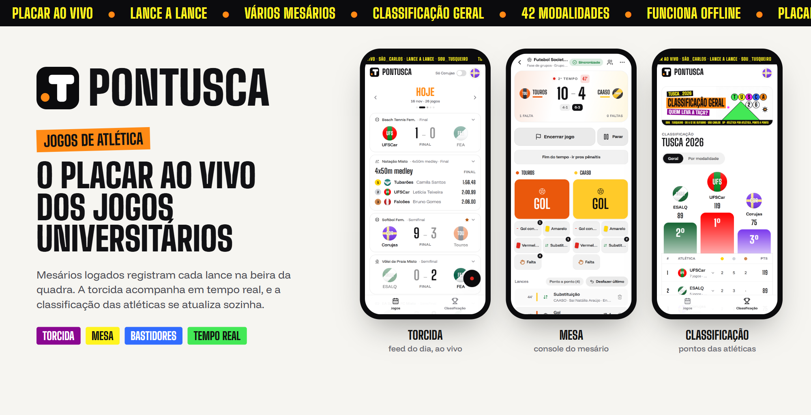
</p>

<p align="center">
  
  
  
  
  
  
</p>

# PONTUSCA

**Placar ao vivo para jogos de atlética.** Um sistema para contar a pontuação de competições universitárias (TUSCA, InterUSP e afins) em tempo real, com **vários mesários logados ao mesmo tempo**, cada um registrando os lances do seu jogo na beira da quadra, e a torcida acompanhando tudo ao vivo pelo celular.

> Pastas e pacotes ainda se chamam `arquibancada` (nome antigo do projeto).

📘 **[COMO-USAR.md](./COMO-USAR.md)**: guia de uso (organização, mesários, torcida, sandbox, celular).

**Sumário:** [O que ele faz](#o-que-ele-faz) · [Como funciona](#como-funciona) · [Fluxos](#fluxos) · [Telas](#telas) · [Cores e tipografia](#cores-e-tipografia) · [Stack](#stack) · [Rodar local](#rodar-local) · [Por dentro](#por-dentro) · [Deploy](#deploy)

## O que ele faz

- **Vários mesários em paralelo.** Cada jogo tem um mesário titular e um reserva, escalados pela organização. Todos ficam logados ao mesmo tempo, cada um no seu jogo, e o console funciona até sem sinal (os lances ficam numa fila e sobem quando a rede volta).
- **Pontuação ao vivo de 42 modalidades.** Futebol, futsal, basquete, handebol, vôlei, tênis, beisebol, natação, atletismo, e-sports e outras, cada uma com seu motor de placar (gols, sets, games, entradas, ranking por tempo ou marca).
- **Classificação geral das atléticas.** Os pontos do torneio são recalculados a cada resultado, com regras configuráveis por modalidade, critérios de desempate e ajustes manuais (bônus, punição).
- **Torcida em tempo real.** Site público sem login, com o placar de todos os jogos, animação de gol, lance a lance, escalações e um print do placar pronto para postar. Aguenta milhares de conexões simultâneas.
- **Painel da organização.** Cadastro de atléticas, modalidades, jogos e mesários, correção de qualquer lance, audiência ao vivo e um sandbox com um robô mesário para testar um dia cheio de jogos.

### As três frentes

| Frente | Endereço | Quem usa | Login |
|---|---|---|---|
| **Torcida** | `/` | qualquer pessoa: feed do dia, jogo lance a lance, classificação, print do placar | não |
| **Mesa** | `/mesa` | **mesários**, na beira da quadra, um por jogo (titular + reserva) | sim |
| **Bastidores** | `/bastidores` | **organização**: torneios, atléticas, modalidades, equipe, jogos, pontuação | sim (admin) |

O painel admin não tem link em nenhum lugar do site público, e o caminho muda com `VITE_ADMIN_PATH` no build.

## Como funciona

Cada jogo é uma **lista de eventos** (gol, cartão, ponto, fim de período…). O placar, o relógio, o período e as estatísticas nunca são gravados "na mão": são sempre recalculados a partir dessa lista pelo motor da modalidade. O mesmo motor roda no servidor e no celular do mesário.

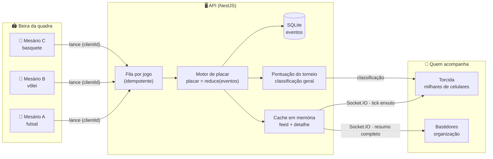

- **Otimista:** o celular do mesário roda o motor localmente e mostra o placar novo na hora, antes de a rede confirmar.
- **Idempotente:** cada toque vira um comando com `clientId`. Se o sinal cair, a fila do aparelho reenvia depois e o servidor ignora duplicatas.
- **Barato pra torcida:** o feed público e o detalhe de cada jogo ficam serializados em memória (JSON + gzip + ETag), então os torcedores não consultam o banco. Medido localmente: **1000 conexões simultâneas recebendo 22 mil atualizações em 20 s, latência p99 de 114 ms**.

## Fluxos

### Um lance, do toque à torcida

O mesário marca o gol e o placar sobe na hora. Quem fez o gol pode ser informado logo depois, ou no intervalo ("marca agora, autor depois").

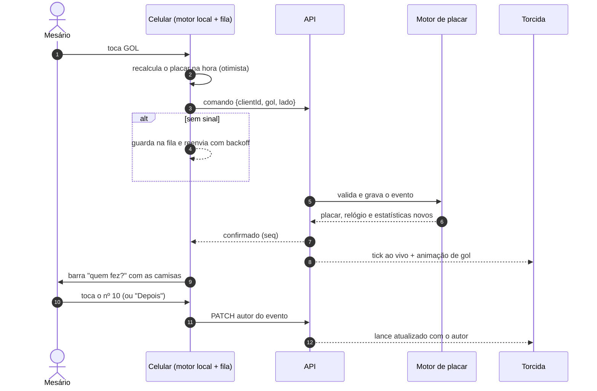

### Organização de um torneio

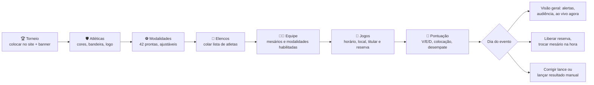

### Vida de um jogo

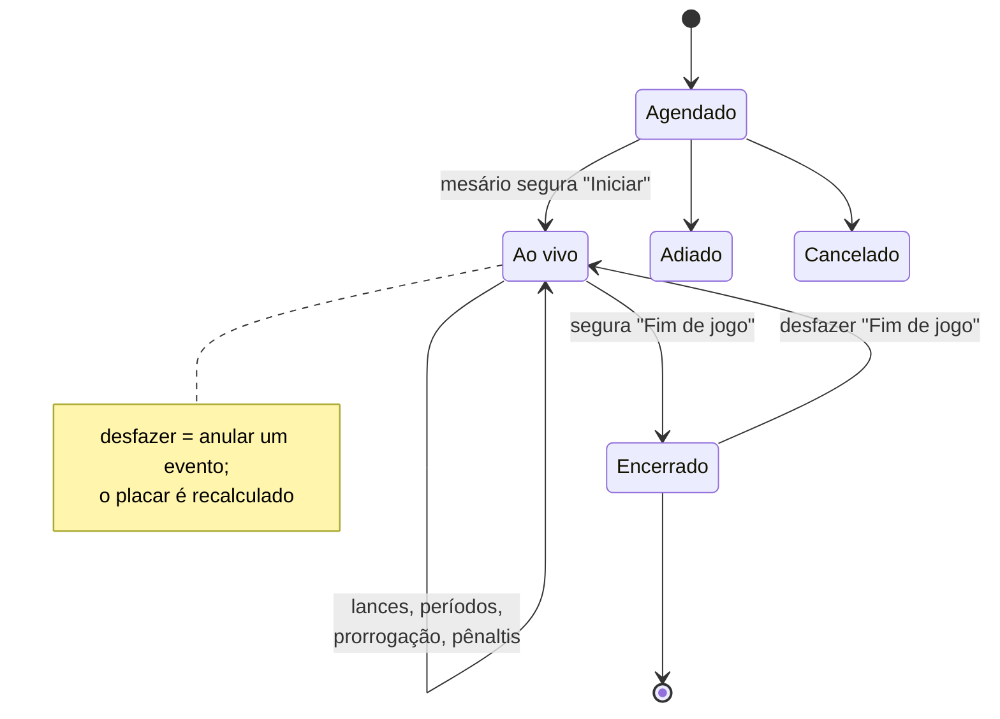

Ações críticas (iniciar, encerrar período ou jogo) pedem **segurar o botão** para confirmar, para evitar toque sem querer.

## Telas

> Capturas do modo sandbox, com atléticas, atletas e mesários de exemplo.

### Torcida

<table>
  <tr>
    <td align="center" width="25%">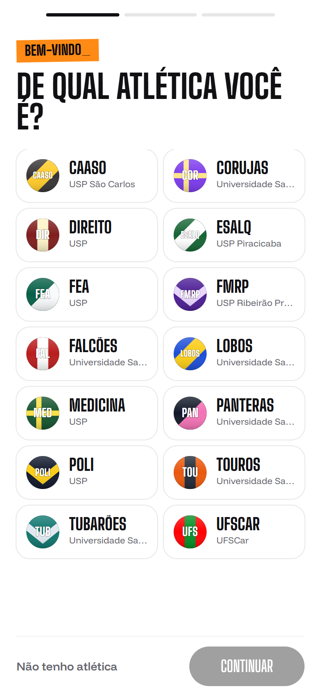<br><sub><b>Boas-vindas</b><br>escolhe a atlética no primeiro acesso</sub></td>
    <td align="center" width="25%">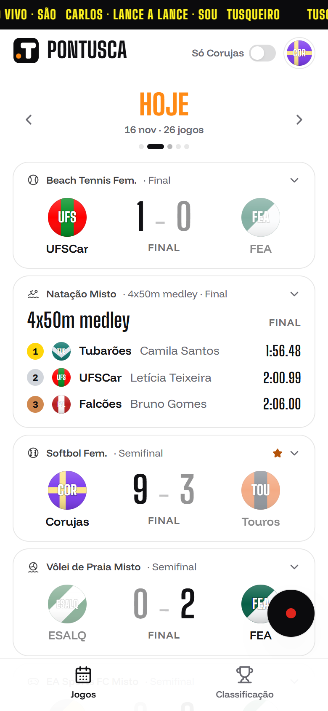<br><sub><b>Feed do dia</b><br>arrasta pro lado pra trocar o dia</sub></td>
    <td align="center" width="25%">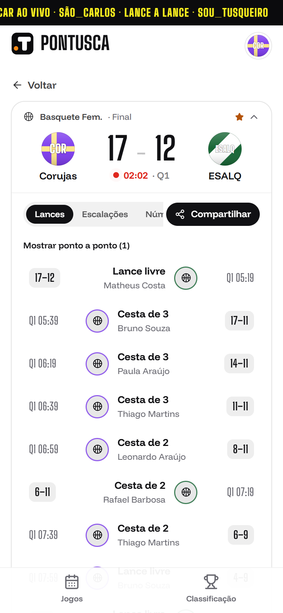<br><sub><b>Jogo</b><br>lance a lance, escalações e números</sub></td>
    <td align="center" width="25%">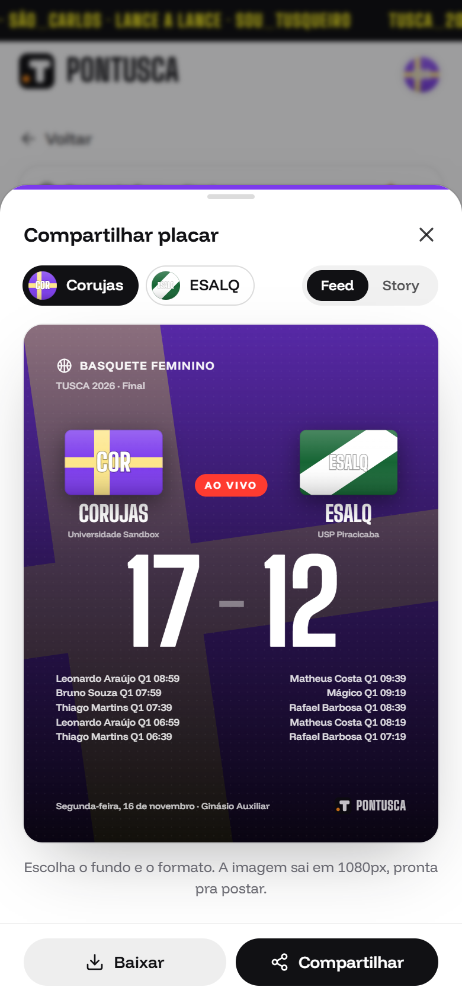<br><sub><b>Compartilhar</b><br>print do placar em feed ou story</sub></td>
  </tr>
</table>

<table>
  <tr>
    <td align="center" width="28%">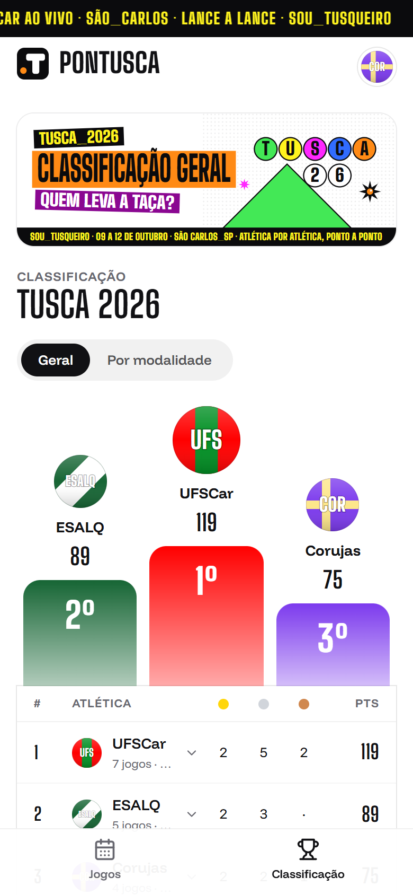<br><sub><b>Classificação</b><br>pódio, medalhas e pontos</sub></td>
    <td align="center" width="72%">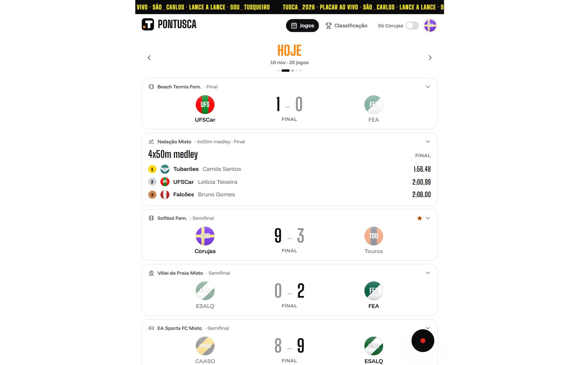<br><sub><b>No computador</b><br>o mesmo feed, centralizado</sub></td>
  </tr>
</table>

### Mesa (mesário)

<table>
  <tr>
    <td align="center" width="33%">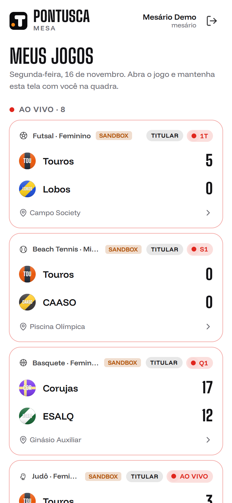<br><sub><b>Meus jogos</b><br>onde o mesário está escalado, titular ou reserva</sub></td>
    <td align="center" width="33%">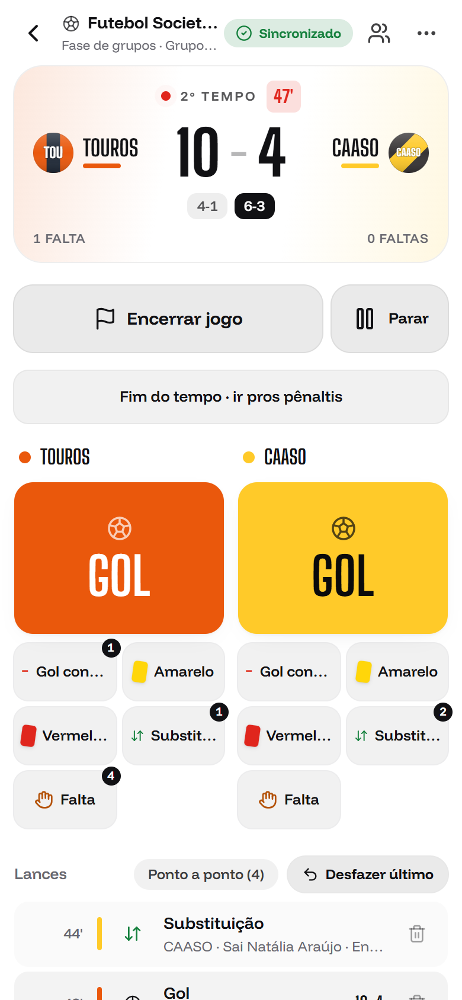<br><sub><b>Console</b><br>botões grandes, cores das atléticas, sincronização</sub></td>
    <td align="center" width="33%">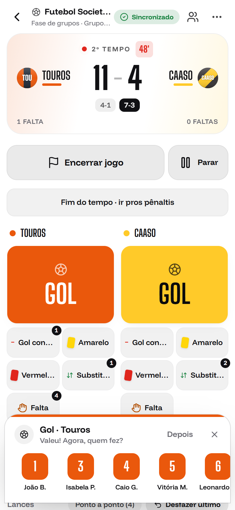<br><sub><b>Quem fez?</b><br>o gol já valeu; o autor vem depois</sub></td>
  </tr>
</table>

### Bastidores (organização)

<p align="center">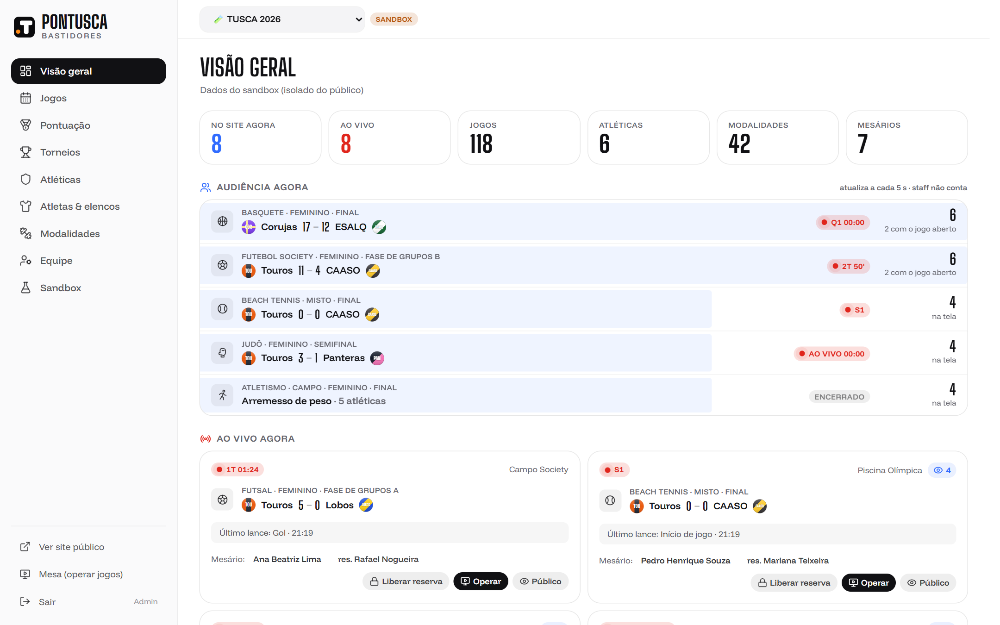<br><sub><b>Visão geral</b>: audiência por jogo, ao vivo agora e o mesário titular e reserva de cada partida</sub></p>

<table>
  <tr>
    <td align="center" width="50%">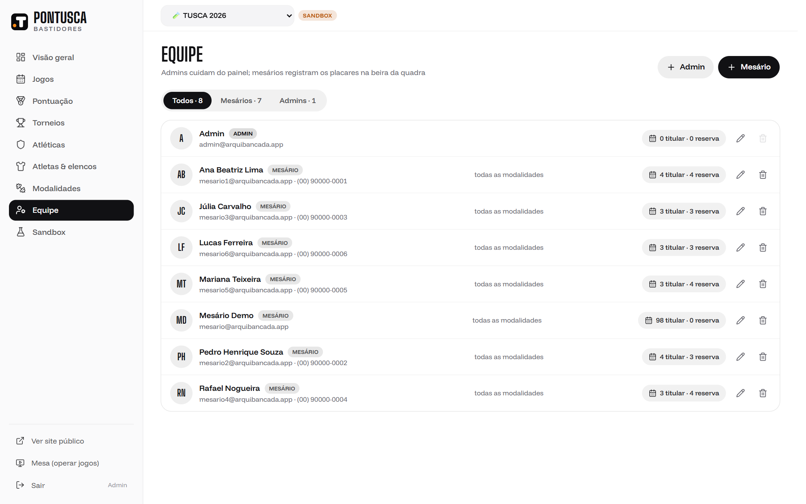<br><sub><b>Equipe</b>: mesários, modalidades habilitadas e escala</sub></td>
    <td align="center" width="50%">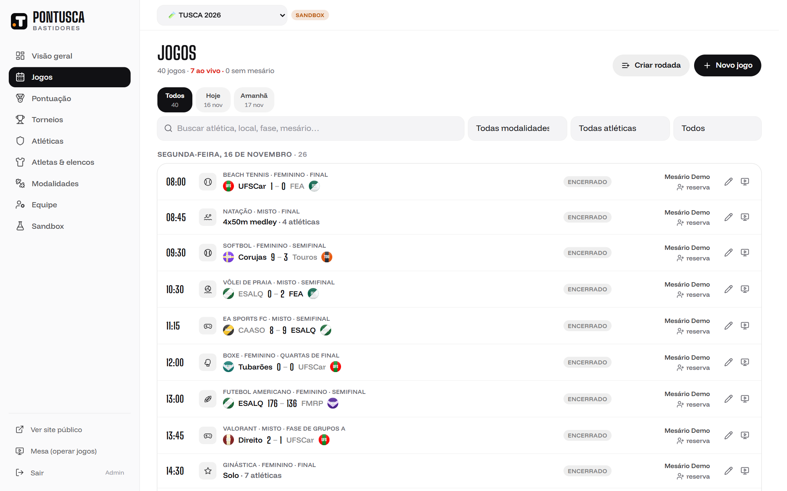<br><sub><b>Jogos</b>: agenda do dia, status e mesário de cada jogo</sub></td>
  </tr>
  <tr>
    <td align="center" colspan="2">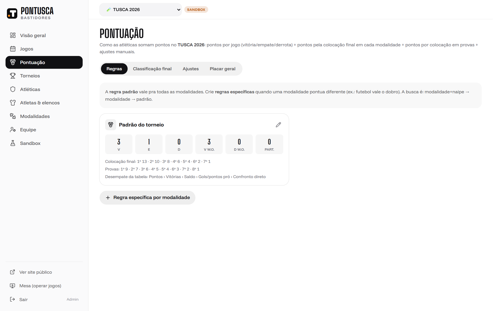<br><sub><b>Pontuação</b>: regras por jogo, colocação final, provas e desempate</sub></td>
  </tr>
</table>

## Cores e tipografia

<p align="center">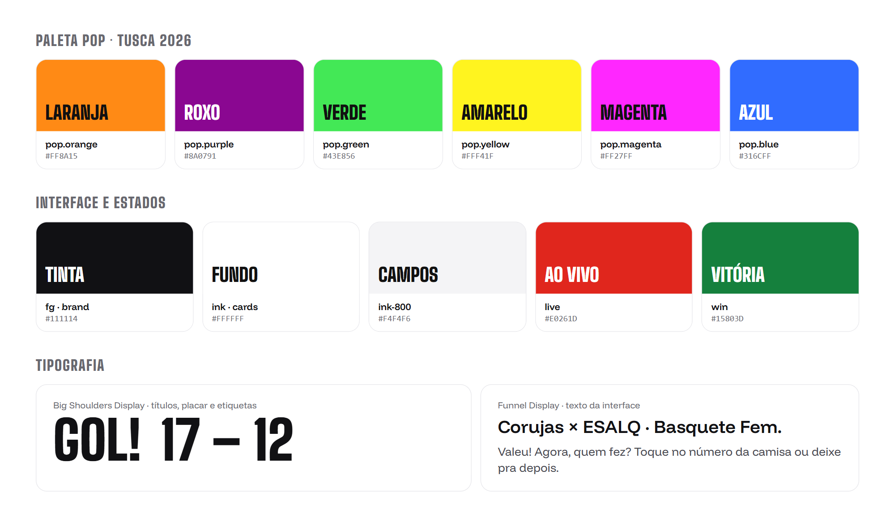</p>

Tema claro, inspirado na identidade do TUSCA 2026: títulos e placares numa condensada pesada, texto numa display arredondada, paleta pop em etiquetas chapadas e ticker preto com texto amarelo. Cada atlética ainda traz **as próprias cores e bandeira**, usadas no card, no console do mesário e no print compartilhável.

| Token | Cor | Onde aparece |
|---|---|---|
| `pop.orange` |  `#FF8A15` | "HOJE", etiquetas, ponto do logo |
| `pop.yellow` |  `#FFF41F` | texto do ticker |
| `pop.purple` |  `#8A0791` | etiquetas e destaques |
| `pop.green` |  `#43E856` | etiquetas e destaques |
| `pop.magenta` |  `#FF27FF` | etiquetas e destaques |
| `pop.blue` |  `#316CFF` | audiência, links |
| `live` |  `#E0261D` | relógio e selo "ao vivo" |
| `win` |  `#15803D` | vencedor, sincronizado |
| `fg` / `brand` |  `#111114` | texto, botões principais |

As cores são variáveis CSS em `web/src/index.css`. Já existe um `[data-theme='dark']` pronto, se um dia quiserem modo noturno.

## Stack

| Camada | Stack |
|---|---|
| API + tempo real | NestJS 10, Socket.IO, Prisma 6, SQLite (WAL) |
| Front | React 18, Vite, Tailwind, framer-motion, TanStack Query |
| Motor de placar | TypeScript puro em `api/src/shared/engine` (o mesmo código roda no servidor e no celular do mesário) |

## Rodar local

```bash
cp api/.env.example api/.env     # ajuste JWT_SECRET/ADMIN_* se quiser
npm run setup                    # instala, cria o banco e roda o seed
npm run dev                      # API :3000 + front :5173
```

Abra http://localhost:5173.

| Área | Endereço | Login de teste (seed, só em dev) |
|---|---|---|
| Público | `/` | — |
| Mesa | `/mesa` | `mesario@arquibancada.app` / `mesario123` |
| Admin | `/bastidores` | `admin@arquibancada.app` / `arquibancada123` (troque a senha no painel) |

O seed é idempotente. Ele cria 42 modalidades, o primeiro admin, 8 atléticas de exemplo e o torneio TUSCA 2026 vazio. **As cores e os nomes das atléticas são placeholders: ajuste em Bastidores → Atléticas** (dá pra subir o logo oficial).

### Sandbox

- **Bastidores → Sandbox** gera um torneio de teste isolado do público, com jogos já encerrados, ao vivo e agendados. O botão "iniciar simulação" põe um robô mesário pra jogar em tempo real, com velocidade de 0,25× a 10×. Ele chama o mesmo `LiveService.command` dos mesários, então testa a cadeia inteira: motor, banco, WebSocket e animações.
- **`/?sandbox=1`** abre o site público em modo sandbox (faixa amarela no topo). `/?sandbox=0` ou o botão "Sair" volta ao normal.
- **`npm run dev:sandbox`** sobe tudo num banco separado (`api/sandbox.db`) com o simulador ligado desde o boot.

### Testes

```bash
npm test          # motor de placar: futebol, pênaltis, vôlei, tênis, beisebol, ranking...
npm run typecheck # api + web
```

## Por dentro

**Placar = reduce(eventos).** Cada jogo é uma lista de eventos (gol, cartão, ponto, fim de período...), e o placar, o relógio, o período e as estatísticas são sempre recalculados a partir dela. Por isso:

- **desfazer** é só anular um evento;
- o admin pode corrigir qualquer lance de um jogo passado;
- o mesário roda o motor localmente e vê o placar mudar na hora, antes de a rede confirmar.

**Motores de placar** (configuráveis por modalidade no painel):

| Motor | Modalidades | O que faz |
|---|---|---|
| `SCORE` | futebol, futsal, basquete, handebol, rugby, futebol americano, polo, lutas, xadrez | Soma ações configuráveis (gol, +2, +3, try +5…). Tem períodos, relógio progressivo ou regressivo, acréscimos, prorrogação, pênaltis e golpes decisivos (ippon, finalização) |
| `SETS` | vôlei, vôlei de praia, futevôlei, tênis de mesa, badminton, e-sports por mapa | Ponto a ponto. O set fecha sozinho no alvo com vantagem; o set decisivo pode ter alvo diferente |
| `TENNIS` | tênis, beach tennis, padel | 15/30/40, vantagem ou no-ad, tie-break, super tie-break e saque alternado |
| `BASEBALL` | beisebol, softbol | Bolas/strikes/outs, entradas alto e baixo, linescore R-H-E, bases e walk-off |
| `RANKING` | natação, atletismo, cheerleading, tiro com arco | Provas sem confronto direto, ordenadas por tempo ou marca |

**Mesário offline.** Cada toque vira um comando com `clientId` e entra numa fila salva no aparelho. A fila é reenviada com backoff quando o sinal volta, e o servidor ignora duplicatas. Ações críticas (iniciar, encerrar período ou jogo) pedem **segurar o botão** pra confirmar.

**Marca agora, autor depois** (estilo SofaScore, em toda modalidade). O toque em gol, cesta, ponto, cartão, substituição, pênalti ou rebatida já vale na hora. Aí sobe a barra "quem fez?" com as camisas, sem travar o próximo lance. O que ficar sem autor vai pra lista "Sem autor", pra preencher no intervalo. A atribuição usa a mesma fila offline, e no servidor é um `PATCH /api/mesa/matches/:id/events/:eventId`.

**Titular e reserva.** Cada jogo tem um mesário titular e um reserva. O reserva só registra quando o admin libera, na hora, em Visão geral ou Jogos. Mesários só podem ser escalados nas modalidades em que estão habilitados.

**Tempo real.** O Socket.IO tem duas salas: `feed` (o resumo de todos os jogos, que alimenta os cards) e `match:<id>`. O feed público e o detalhe de cada jogo ficam serializados em memória, então os torcedores não fazem consulta ao banco. Medido localmente: **1000 conexões simultâneas recebendo 22 mil atualizações em 20 s, latência p99 de 114 ms**.

**Feed por dia (home).** Uma tela por dia, sem filtros: arrastar pro lado troca o dia (setas do teclado no desktop). Abre fixado no jogo do momento (ao vivo de qualquer dia > último encerrado > primeiro do dia) via âncora `#jogo-<id>` — que também serve de link compartilhável. Botão redondo flutuante leva pro jogo ao vivo (some se não há jogo ou se ele já está na tela). Switch "Só <atlética>" no topo filtra pela atlética do torcedor. Regras em `web/src/lib/feed.ts`, testadas em `feed.test.ts` (Vitest).

**Torneio do momento.** O público não escolhe torneio: vê só o que o admin marcou em Bastidores → Torneios → "Colocar no site" (um por ambiente, real e sandbox). Cada torneio pode ter um **banner** (upload ou URL, com link opcional) exibido no topo da Classificação. O modelo `web/public/banners/tusca-2026.svg` vem pronto.

**Pontuação do torneio** (Bastidores → Pontuação):

- regra padrão do torneio, que pode ser sobrescrita por modalidade e naipe: vitória, empate, derrota, vitória/derrota por W.O. e participação;
- pontos pela classificação final de cada modalidade (ex.: 13, 10, 8…) e pontos por colocação em cada prova de ranking;
- critérios de desempate do placar geral (mais ouros, vitórias, saldo…) e das tabelas por modalidade (confronto direto, saldo…), em ordem configurável;
- ajustes manuais de pontos com motivo: bônus, punição, correção.

## Deploy

É uma imagem só: o Nest serve a API, o WebSocket e o front buildado. No boot ela roda `prisma db push`, depois o seed e só então sobe.

**Fly.io** (região GRU):

```bash
fly launch --no-deploy --copy-config
fly volumes create arquibancada_data --region gru --size 1
fly secrets set JWT_SECRET=$(openssl rand -hex 32) ADMIN_EMAIL=voce@exemplo.com ADMIN_PASSWORD='senha-forte'
fly deploy
```

Ajuste `app` e `WEB_ORIGIN` no `fly.toml`. **Rode uma máquina só**: o SQLite e o barramento ao vivo são locais. Uma instância aguenta folgado um torneio universitário. Se um dia precisar escalar horizontalmente:

1. troque o provider do Prisma pra `postgresql` (o schema não usa nada específico do SQLite);
2. adicione o adapter Redis do Socket.IO.

Qualquer host com Docker e volume persistente serve (Railway, Render, VPS). Monte o volume e aponte `DATABASE_URL=file:/caminho/no/volume.db`.

## Estrutura

```
api/
  prisma/schema.prisma        modelos (atléticas, modalidades, jogos, eventos, regras...)
  src/shared/                 tipos + catálogo de modalidades + motor (compartilhado com o web)
  src/live/                   LiveService (fila por jogo, cache, broadcast), gateway, API do mesário
  src/public/                 feed público em memória
  src/standings/              classificação geral e tabelas por modalidade
  src/admin/                  CRUDs do painel
  src/sandbox/                gerador + simulador
  src/seed/seed.ts
web/
  src/pages/public/           feed, jogo, classificação, atlética
  src/pages/mesa/             console do mesário
  src/pages/admin/            Bastidores
  src/components/match/       card, detalhe, print compartilhável, comemoração
  src/components/ui/          bandeiras, ícones de modalidade, sheets, botão de segurar
```
